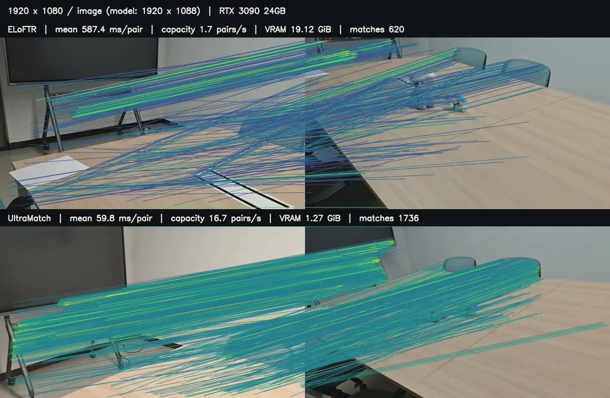
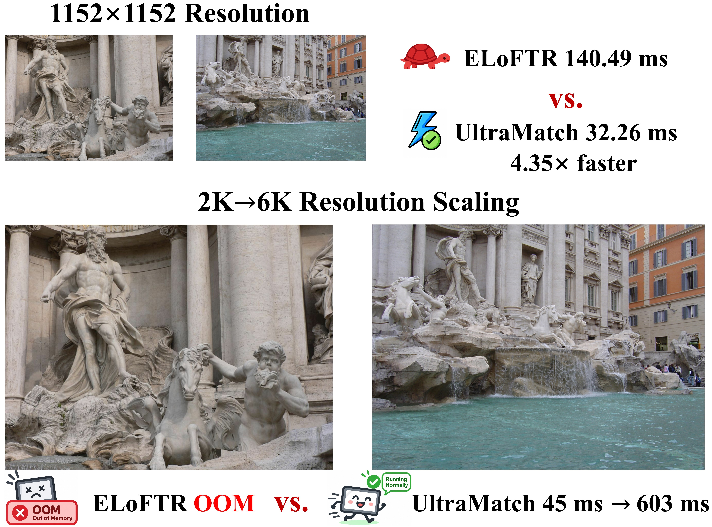
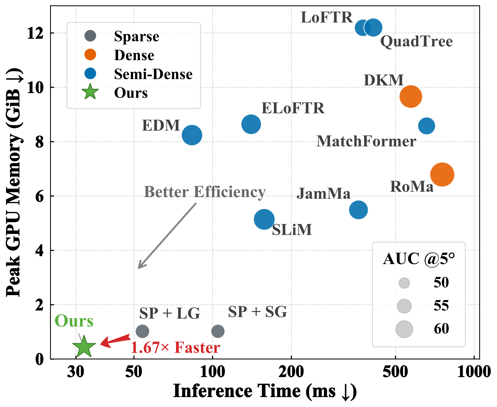
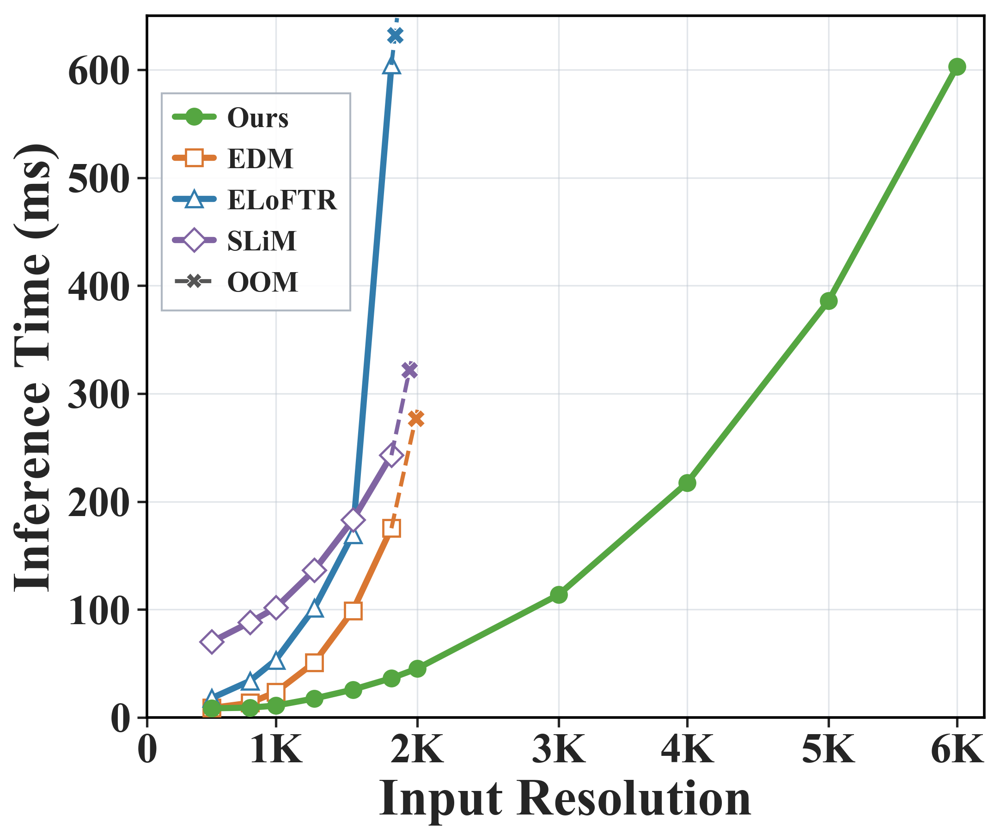
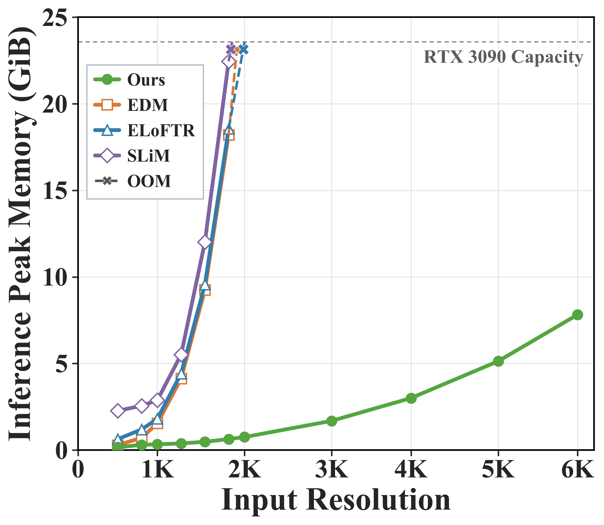
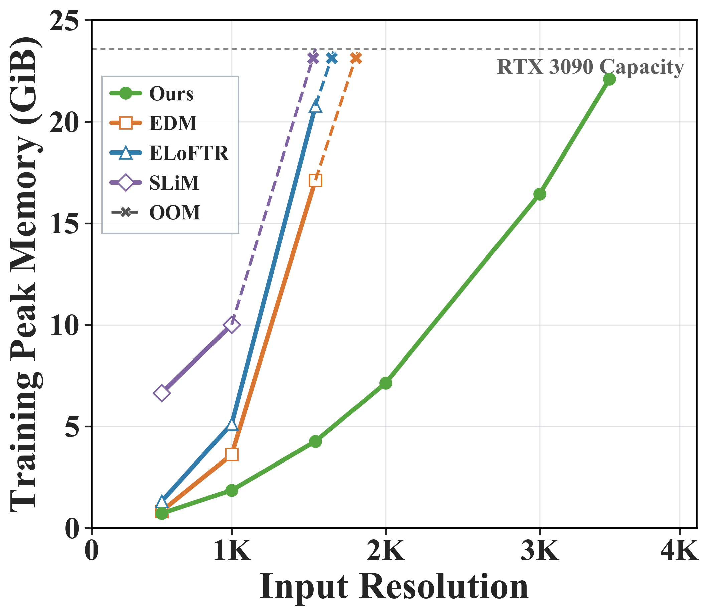
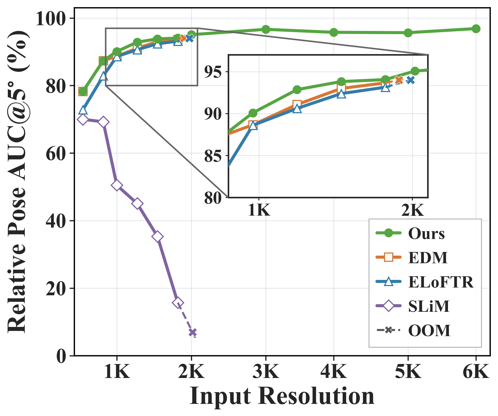
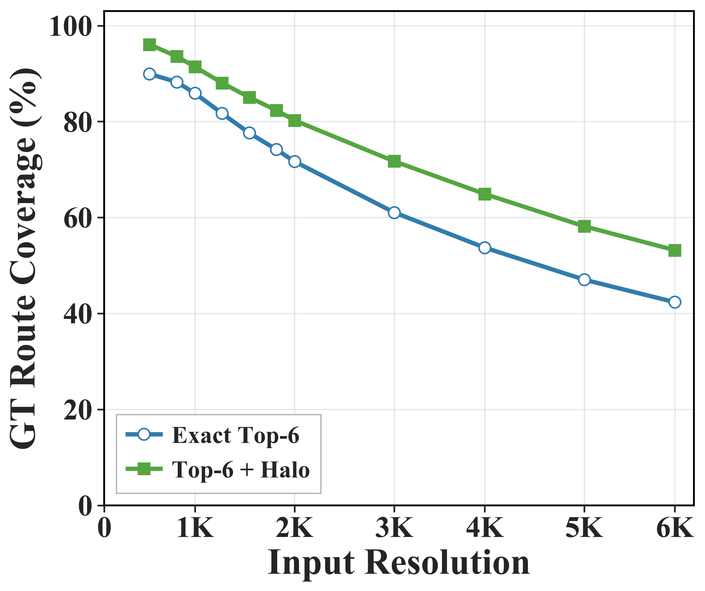
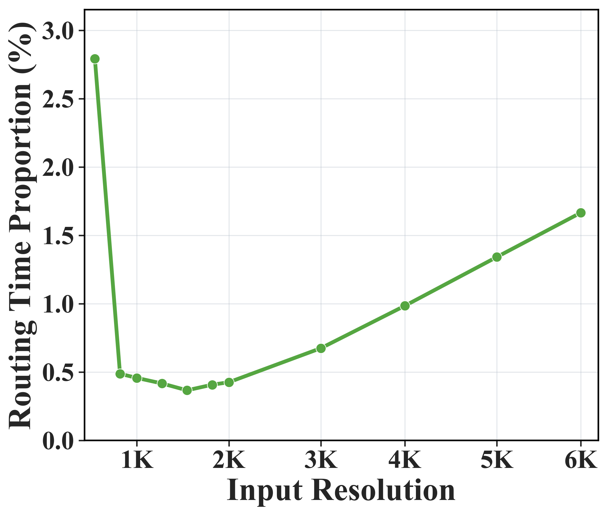

<h1 align="center">UltraMatch: Transport Path Routing for Ultra-Fast and Memory-Efficient Image Matching</h1>

<h3 align="center">
  <a href="https://scholar.google.com/citations?user=uWhzrG4AAAAJ&hl=zh-CN">Jiajun Le</a><sup>1</sup> &middot;
  <a href="https://scholar.google.com/citations?user=h-9Ub_cAAAAJ&amp;hl=zh-CN">Yifan Lu</a><sup>1</sup> &middot;
  <a href="https://scholar.google.com/citations?user=bxuEALEAAAAJ&amp;hl=zh-CN">Zizhuo Li</a><sup>1</sup> &middot;
  <a href="https://scholar.google.com/citations?user=LaT72N4AAAAJ&amp;hl=zh-CN&amp;oi=sra">Lei Cao</a><sup>1,2</sup> &middot;
  <a href="https://scholar.google.com/citations?user=WNH2_rgAAAAJ&amp;hl=zh-CN">Junjun Jiang</a><sup>3</sup> &middot;
  <a href="https://scholar.google.com/citations?user=73trMQkAAAAJ&amp;hl=zh-CN&amp;oi=sra">Jiayi Ma</a><sup>1,4,*</sup>
</h3>

<p align="center">
  <sup>1</sup>Electronic Information School, Wuhan University<br>
  <sup>2</sup>Xiaomi Corporation<br>
  <sup>3</sup>School of Computer Science and Technology, Harbin Institute of Technology<br>
  <sup>4</sup>School of Robotics, Wuhan University
</p>

<p align="center">
  <sup>*</sup>Corresponding author
</p>

<p align="center">
  <a href="https://arxiv.org/abs/2609.36980"></a>
  <a href="#citation"></a>
</p>

<table width="100%" align="center">
  <tr>
    <td width="100%" align="left">
      <details open>
        <summary>
          &nbsp; UltraMatch video demo<br>
          
        </summary>
        
      </details>
    </td>
  </tr>
</table>
<p align="center">
  <a href="https://github.com/JiajunLe/UltraMatch/raw/refs/heads/main/assets/ultramatch-eloftr-demo.mp4">Download video (MP4)</a>
</p>

## News

**[2026-09-29]** The UltraMatch paper has been submitted to arXiv.

<a id="overview"></a>
<details>
<summary><strong>Overview</strong></summary>

**UltraMatch is an efficient, scalable semi-dense image matcher that routes computation to a small set of promising matching paths.** Instead of constructing a full token-to-token matching matrix, a lightweight **Transport Path Router** ranks candidate target blocks for each source block and retains only a small subset. Matching then runs over the selected paths.

<p align="center">
  
</p>


In the reported experiments, UltraMatch is **1.67x faster than SuperPoint+LightGlue** and **4.35x faster than ELoFTR**, with **0.44 GiB** peak inference memory on MegaDepth-1500. On ETH3D, it supports image pairs at **6048 x 4032** resolution on a single RTX 3090. The routing strategy can be readily **integrated into other semi-dense matchers**.

</details>

## Results

<a id="accuracy-and-efficiency"></a>
<details>
<summary><strong>Accuracy and efficiency</strong></summary>

<p>
  
  
</p>
<br clear="all">

</details>

<a id="high-resolution-scalability"></a>
<details>
<summary><strong>High-resolution scalability</strong></summary>

<p align="center">
  
  
  
</p>
<p align="center">
  
  
  
</p>

</details>

<a id="transferability-of-transport-path-routing"></a>
<details>
<summary><strong>Transferability of Transport Path Routing</strong></summary>

AUC, runtime, and memory are shown as **Original / Routing**.

| Method | AUC@10° ↑ | End-to-end (ms) ↓ | Coarse matching (ms) ↓ | Memory (GiB) ↓ |
| :--- | :---: | :---: | :---: | :---: |
| ELoFTR | 71.2 / **71.9** | 141.61 / 76.41 (**1.85×**) | 77.88 / 7.46 (**10.44×**) | 8.64 / 2.02 (**−76.6%**) |
| JamMa | 70.6 / **71.3** | 362.64 / 187.05 (**1.94×**) | 204.54 / 7.05 (**29.02×**) | 5.49 / 1.43 (**−74.0%**) |
| SLiM | **69.2** / 68.5 | 193.30 / 147.30 (**1.31×**) | 59.72 / 14.22 (**4.20×**) | 5.14 / 4.06 (**−21.0%**) |
| EDM | 71.2 / **72.1** | 83.58 / 41.56 (**2.01×**) | 47.74 / 4.73 (**10.09×**) | 8.24 / 0.60 (**−92.7%**) |

</details>


## Installation

Run these commands from the repository root on Linux with a CUDA-capable GPU. The evaluation scripts use PyTorch 2.0.0 with CUDA 11.8.

```bash
conda env create -f environment.yaml
conda activate ultramatch
python -m pip install torch==2.0.0 torchvision==0.15.1 --index-url https://download.pytorch.org/whl/cu118
python -m pip install -r requirements.txt
```

## Single-pair demo

Download [outdoor.ckpt](https://github.com/JiajunLe/UltraMatch/releases/download/v1.0.0/outdoor.ckpt) and save it as `weights/outdoor.ckpt`. The same MegaDepth-trained weights are used for indoor and outdoor images. The notebook runs inference on the included ScanNet and PhotoTourism examples and draws the matched points. [Open the demo](demo_single_pair.ipynb).

Import the Python model with `from src.ultramatch import UltraMatch`. The indoor and outdoor model settings live in `configs/ultramatch/` under `cfg.ULTRAMATCH`. New checkpoints use the parameter prefix `ultramatch.`. The loader also accepts earlier checkpoints with the `matcher.` prefix.

## Evaluation

Download the MegaDepth-1500 and ScanNet-1500 test subsets. Place or link their contents under `data/megadepth/test/` and `data/scannet/test/`, respectively. MegaDepth expects `Undistorted_SfM/` under its test directory. ScanNet expects the `scene*` directories under its test directory. The pair lists, poses for MegaDepth, and ScanNet intrinsics are in `assets/`. [LoFTR test data](https://drive.google.com/drive/folders/1DOcOPZb3-5cWxLqn256AhwUVjBPifhuf).

```bash
bash scripts/reproduce_test/outdoor.sh   # MegaDepth-1500, 1152 × 1152
bash scripts/reproduce_test/indoor.sh    # ScanNet-1500, 640 × 480
```

Both scripts use GPU 0 by default and report pose AUC at 5°, 10°, and 20°. Use `GPU_ID` to select another GPU or `CKPT_PATH` to evaluate a different checkpoint. The default pose solver uses OpenCV. For the optional `test.py --ransac LO-RANSAC` solver, install PoseLib with `python -m pip install poselib==2.0.4`.

The scripts use the settings in the model and data configuration files. To override a setting for one run, pass it to the script, for example `bash scripts/reproduce_test/outdoor.sh --route_topk 4`. The default BF16 feature extraction falls back to FP32 on GPUs without BF16 support.

## Training

Prepare the MegaDepth images, depth maps and scene indices. The training configuration reads the dataset from `data/megadepth/train/`, the validation images and depth maps from `data/megadepth/test/`, and the scene indices from `data/megadepth/index/`. [LoFTR data preparation](https://github.com/zju3dv/LoFTR/blob/master/docs/TRAINING.md).

```bash
bash scripts/reproduce_train/outdoor.sh
```

The default run uses four GPUs, a batch size of eight per GPU, and 30 epochs. The script saves checkpoints in `logs/tb_logs/ultramatch/version_*/checkpoints/`.

To resume training, set `RESUME_CKPT_PATH` to a file in the run's `checkpoints/recovery/` directory.

## Acknowledgements

UltraMatch is based on the [EDM codebase](https://github.com/chicleee/EDM). We retain its dense coarse-matching loss and ScanNet matching thresholds.

We also use code from [EfficientLoFTR](https://github.com/zju3dv/EfficientLoFTR) and [Residual Log-likelihood Estimation](https://github.com/Jeff-sjtu/res-loglikelihood-regression).

## Citation

If you find UltraMatch useful in your research, please cite our work. 

```bibtex
@article{le2026ultramatch,
  title={UltraMatch: Transport Path Routing for Ultra-Fast and Memory-Efficient Image Matching},
  author={Le, Jiajun and Lu, Yifan and Li, Zizhuo and Cao, Lei and Jiang, Junjun and Ma, Jiayi},
  journal={arXiv preprint arXiv:2609.36980},
  year={2026}
}
```
